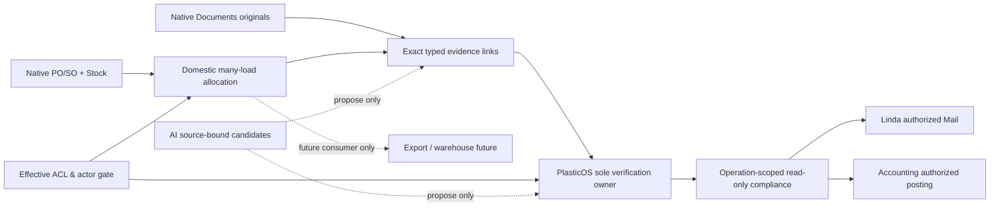

# PlasticOS | Strategic + capability + implementation layers

**All views in this ZIP are non-admitted working artifacts.** `Quantum-L9/.github@3dcdeaae355b6de08562993f705084d7a3714bfd` owns the global strategic-plan semantics. The inspected historical working baseline is `Quantum-L9/l9-wip PR #31@ae237562...`, `Strategic_Plan_v1.19.0/strategy_graph_working_outline.yaml`; it is **not proven the latest plan**. Therefore `02_STRATEGIC_GRAPH_CANDIDATES.json` is an additive delta, **not** a canonical plan revision and not an approved new strategic commitment.

## Three non-competing layers

| Layer | File | What it owns | What it must never claim |
|---|---|---|---|
| **Plan-owned strategic candidates** | `02_STRATEGIC_GRAPH_CANDIDATES.json` | Four kinds: goal, target, hypothesis, commitment. Five relations: advances, enables, depends_on, conflicts_with, supersedes. | Owner identity, capability implementation state, API/DB reality, approvals, or a fifth primitive. |
| **Domain capability/ownership** | `11_CAPABILITY_OWNERSHIP_AND_IMPLEMENTATION_GRAPH.json` | Capability names, owner axes, consumed evidence, interactions and candidate guard conditions. | Canonical Strategic Authority, runtime test success, implementation permission. |
| **Readiness/assurance/work queue** | `03_DOMAIN_PHASE_AND_DEPENDENCY_VIEW.json`, `12...json`, `16...json`, `17...json` | Remediation obligations, exact source observations, open operator decisions, phase/wake triggers, required test receipts. | Altering Plan nodes/relations or silently promoting proposed design to implemented. |

## Strategic placement

Existing Plan anchors reused: `G-02` (Scrap profitability), `TAR-01` (usable Odoo), `TAR-10` (production readiness), `C-02/C-03` (priority and human gates). Current first-package candidates `TAR-POS-DOC`, `TAR-POS-AI`, `TAR-POS-FUTURE`, `C-POS-FOUNDATION`, `H-POS-NATIVE` retain their identities and statements. The additional candidates `TAR-POS-VERIFY`, `TAR-POS-EXACT`, `TAR-POS-MULTILOAD`, `TAR-POS-ACCESS`, `TAR-POS-LAW`, `C-POS-REPAIR`, `H-POS-TRUTH` refine existing parents, not duplicate the global roots. The Plan makes no claims about deployed state.

## Capability/owner flow (not a fifth Plan primitive)

Arrows represent candidate owner interfaces or evidence dependencies, not code calls or permission to mutate. In particular `C --> F` is evidence eligibility only: compliance does not post an invoice. Native AI never writes business verification. Export is an optional future consumer, **not** a predecessor of the domestic many-load foundation.

## Dependency delta vs prior 14-item graph

**Mandatory first design proofs:** fix owner design `PL-ARCH-02`, exact association contract `PL-ARCH-03`, native multi-load contract `PL-ARCH-06`, policy candidates `PL-DEC-SEED`, `PL-DEC-GATE`, `PL-DEC-ACL`; stable invariants admission `PL-ADMIT-INV` depends on those *adjudications*, not Export.

**Required code repairs only after separate execution authority:** `PL-FIX-DOC-WRITER`, `PL-FIX-DOC-MATCH`, `PL-FIX-DOC-COMPLIANCE`, `PL-FIX-LOG-CARDINALITY`, `PL-FIX-ACL`. Verification nodes `PL-READY-DOC/LOG/ACL` distinguish testing from code presence. No work item may claim PASS without exact head/fixture/negative-case receipts.

**Production readiness:** existing protected `PL-MVP-01` remains top focus. If actual release scope consumes native Docs verification/auto-link or broad ACLs, it must prove those affected repairs before activation; if it consumes multi-load physical shipment, it must also prove `PL-READY-LOG`. This is not a promise that a hypothetical limited MVP can ignore a known security exposure. **Actual operator-approved release gate and security review decide release scope.**

**No false predecessors:** neither `PL-FUT-01` Export, `PL-FUT-02` warehouse/shop-floor, nor `PL-AI-03` live AI may block core manual Documents processing. None is activated. No custom booking module, drayage contract, scale hardware, separate scheduler or Export report is part of the authorized current work.

## Placement rejection and adversarial counterexample

**Rejected option:** Put Docs verification and Export booking ownership into a new shared `plasticos_operations` core. This duplicates `plasticos_documents`, `plasticos_logistics`, native Documents, Stock and Mail. Counterexample: one supplier PDF relevant to two distinct PO/picking quantities would have competing original, verification and reminder owners.

**Accepted proposal:** retain each established owner; the capability graph records boundaries and noncanonical implementation evidence. Multi-load is a domain correctness repair with direct domestic consumers, not Export-specific implementation. A previously closed transaction that has multiple physical deliveries is the falsifying counterexample for the current `transaction.load_id` slot.

## Operator-visible readiness now

- **Confirmed source defects:** dual verification, partner-recency link, single-slot load model with related consumers and buyer guard, broad base user ACL rows.
- **Accepted semantic ruling needing constitutional cleanup:** ADR-013 typed fail-closed behavior supersedes empty-success fallback.
- **Proposed constitutional adjudication:** per-record-family seed `noupdate` lifecycle with preserved external IDs; needs operator approval.
- **Proposed security decision:** least-privilege ACL matrix; exact roles not yet operator-admitted.
- **NOT_RUN:** new Odoo 19 Enterprise corrective tests, rollback rehearsal, production proof, AI integration, Export and warehouse implementation.
