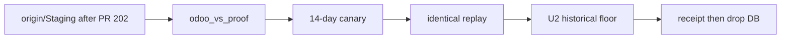

# PLAN: VanillaSoft CRM import

Release-candidate rehearsal of the existing importer in [`plasticos_crm_sync/scripts/import_vanillasoft_shell.py`](plasticos_crm_sync/scripts/import_vanillasoft_shell.py). Run it only after PR #202 is on `origin/Staging`, on a disposable proof database, independently of the constellation end-to-end campaign.

Do not edit the importer. Do not enable the cron. Do not use Settings. Do not export the secret from the agent. Do not write to VanillaSoft. Do not run LegacyErp in this plan.

## Execute via Cursor Build

PR #202 merged to `Staging` on 2026-10-01 at `c9707f6a0066665f0177a138e1a2a8008ab62c7c`. Do not write that commit, or the current checkout HEAD, in as a frozen `source_sha`. At Build, `source_sha` is `git rev-parse origin/Staging`, and `c9707f6a0066665f0177a138e1a2a8008ab62c7c` must be an ancestor. U2 is still required before history. Do not reuse `feat/gate-consumer-bind` or `bdebcda028cb0d5f75ff2b9e22c8c8c3f548665c`.

- Git `write_allow` is empty. Do not commit, do not run `make pr`, and do not invent a PR URL.
- Do not run `make campaign`.
- Do not admit a Program Lock.
- Do not write `Lock: origin/main = <sha>`.
- Do not paste secret material into chat or into the summary JSON.

## Metadata

| Field | Value |
|-------|-------|
| plan_id | `plan.plasticos.vanillasoft-crm-import.v1` |
| name | VanillaSoft CRM import |
| overview | Staging rehearsal of `make import-vanillasoft` on proof database `odoo_vs_proof`. |
| schema_version | `1.0.0` |
| status | `draft` |
| is_project | `false` |
| owner | operator |
| created_at | `2026-09-30` |
| updated_at | `2026-10-01` |

## Architect framing

| Field | Value |
|-------|-------|
| planning_ssot | [`docs/runbooks/CRM_SYNC_VANILLASOFT.md`](docs/runbooks/CRM_SYNC_VANILLASOFT.md) and `SyncOrchestrator.run_full_import` |
| plan_class | `migration_plan` |
| redesign_allowed | `false` |
| follow_on_schema_evolution_separate | `true` |
| framing_notes | Rehearsal of the settled importer. Not a Gate change. Not the production cutover. |

## Immutable baseline

| Field | Value |
|-------|-------|
| captured_at | at Build start |
| repository | `cryptoxdog/IB-Odoo_19` |
| source_ref | `origin/Staging` |
| source_sha | unresolved until Build: `git rev-parse origin/Staging` |
| floor_commit | `c9707f6a0066665f0177a138e1a2a8008ab62c7c` (PR #202 merge, 2026-10-01) |
| precondition | `git merge-base --is-ancestor c9707f6a0066665f0177a138e1a2a8008ab62c7c source_sha` |
| superseded | checkout HEAD, `feat/gate-consumer-bind`, and `bdebcda028cb0d5f75ff2b9e22c8c8c3f548665c` |
| dirty | allowed only for paths this plan does not stage |
| overlap_policy | `explicitly_allow_listed_paths` |
| verification_rule | `reverify_at_execution_start` |
| on_drift | `stop_and_replan` |

If `c9707f6a0066665f0177a138e1a2a8008ab62c7c` is not an ancestor of `origin/Staging` at start, stop. Do not run the import from the checkout HEAD or the old feature SHA.

## Objective

### Mission

Prove the existing VanillaSoft full import against live project `139705` on a database created for this rehearsal. Canary and replay stay inside the 31-day contact lookback. History starts at U2, the operator's earliest required date, not a hard-coded year.

### Success properties

| id | property | evidence_type | proof | blocking |
|----|----------|---------------|-------|----------|
| SP-01 | Execution SHA is `origin/Staging` and contains the #202 merge | `repository_state` | `git rev-parse origin/Staging` recorded at start, and `git merge-base --is-ancestor c9707f6a0066665f0177a138e1a2a8008ab62c7c source_sha` | true |
| SP-02 | Canary data matches sampled provider identities | `runtime_behavior` | `final_status=success`, `duplicates=0`, duplicate SQL returns 0 rows, and 5 to 10 sampled contacts match lead, external ref, calls, and custom-table parent | true |
| SP-03 | History is complete only for the U2 floor | `human_confirmation` | both floors equal U2; `success`, or `partial` plus distinct `vanillasoft_id` equal to the VanillaSoft project contact count | true |
| SP-04 | Cron stayed inactive | `runtime_behavior` | `PlasticOS CRM Sync (VanillaSoft)` `active=false` before and after | true |
| SP-05 | Key was present and not disclosed | `runtime_behavior` | presence boolean true; no key characters in logs | true |
| SP-06 | No tracked diff | `repository_state` | nothing staged | true |
| SP-07 | Only the proof database was mutated | `runtime_behavior` | every shell and import used `ODOO_DB_NAME=odoo_vs_proof`; database `odoo` was not imported into | true |
| SP-08 | Replay added no provider identity and did not rewind watermarks | `runtime_behavior` | lead distinct count unchanged, duplicate SQL still 0, both watermarks greater than or equal to the post-canary values | true |

## Capability preflight

| id | capability | command_or_action | pass_criteria | blocking |
|----|------------|-------------------|---------------|----------|
| CP-00 | `staging_contains_202` | `git fetch` then rev-parse `origin/Staging` | `c9707f6a0066665f0177a138e1a2a8008ab62c7c` is an ancestor of that SHA | true |
| CP-01 | `venv` | `make venv` | `.venv/bin/python` exists and is used for `scripts/validate_import_summary.py` | true |
| CP-02 | `proof_db_runtime` | see bootstrap fork below | either a sanctioned clone exists, or the run stops | true |
| CP-03 | `module_on_proof_db` | module state on `odoo_vs_proof` | `plasticos_crm_sync` installed and `crm_lead.vanillasoft_sync_archived` exists | true |
| CP-04 | `cron_inactive` | `ir.cron` on the proof DB | active is false | true |
| CP-05 | `secret_name` | already recorded | `VANILLASOFT_API`, VerifyKey HTTP 200, project `139705` | true |
| CP-06 | `u2_floor` | operator input | one ISO UTC instant, not in the future, written into this plan before history | true |
| CP-07 | `snapshot` | `ODOO_DB_NAME=odoo_vs_proof make backup` | backup file exists before `set_param` | true |

### Proof database fork

`make import-vanillasoft` already selects the database with `ODOO_DB_NAME`. This rehearsal sets `ODOO_DB_NAME=odoo_vs_proof` on every import, shell, and backup.

Creating that database is sanctioned only where the repo already clones one:

- Local runtime, Docker not selected: `createdb -h "$L9_PG_HOST" -p "$L9_PG_PORT" -U "$L9_PG_USER" -T plasticos_template odoo_vs_proof`, the same clone `gate-db` and `test-odoo-local` use. Teardown is `dropdb` of that name only.
- Docker is up, so `make import-vanillasoft` will use Docker. There is no Makefile target that creates a second Docker database. **Stop.** Do not run `docker compose exec db createdb`. The preserved compensation, if a rehearsal on the existing Docker database is later authorized as its own plan, remains snapshot and restore. It is not this plan.

`make update` does not pass `-d`. Do not use it here. It would upgrade the Docker default database `odoo`. If the template clone lacks `plasticos_crm_sync`, stop. Do not install it by a new command.

## Execution envelope

### Filesystem

- **write_allow:** none in git. Runtime writes are database `odoo_vs_proof`, `.l9/pr/import-vanillasoft-summary.json`, the sample receipt, and `backup_*.sql`.
- **write_deny:** tracked paths, `.env`, database `odoo`, `plasticos_crm_sync/**`, `ops/secrets/**`.
- **delete_allow:** `dropdb` of `odoo_vs_proof` only, after the receipt is saved.

### Commands

- **allow:** `make venv`, `git rev-parse`, `git merge-base --is-ancestor`, local `createdb`/`dropdb` of `odoo_vs_proof` from `plasticos_template`, `ODOO_DB_NAME=odoo_vs_proof make backup`, `ODOO_DB_NAME=odoo_vs_proof make import-vanillasoft` with explicit floors, `python3 scripts/validate_import_summary.py` via `.venv`, read-only SQL.
- **deny:** agent `hydrate_infisical.py --export`, Settings UI, cron activation, `make update`, `make campaign`, `git commit`, `git push`, `make pr`, any command whose database is `odoo`, any VanillaSoft method other than the importer's existing reads.

### Network

| Field | Value |
|-------|-------|
| mode | `named_services_only` |
| allowed_services | `https://app.infisical.com`, `https://vanillasoft.net` |

VanillaSoft traffic is read-only. VerifyKey and the importer's contact and call reads do not mutate the provider.

### Secrets

| Field | Value |
|-------|-------|
| access | `runtime_injected_only` |
| name | `VANILLASOFT_API` |
| redaction_required | `true` |

### Autonomous merge

`autonomous_merge:` `false`.

## Side effects and idempotency

Schema vocabulary only. `network_write` and `external_state_mutation` do not apply. VanillaSoft is `network_read`. The summary file is `filesystem_mutation`.

| todo_id | side_effects | idempotency | retry | compensation | irreversible |
|---------|--------------|-------------|-------|--------------|--------------|
| todo-00-bind-staging | `filesystem_read` | `safe_to_repeat` | `retry_once` | none | false |
| todo-01-bootstrap | `database_write` | `safe_to_repeat` | `manual_only` | `dropdb odoo_vs_proof` | false |
| todo-03-set-param | `database_write` | `safe_to_repeat` | `manual_only` | drop the proof DB | false |
| todo-04-canary | `database_write` | `safe_with_dedupe` | `manual_only` | drop the proof DB | false |
| todo-05-replay | `database_write` | `safe_with_dedupe` | `manual_only` | drop the proof DB | false |
| todo-06-history | `database_write` | `safe_with_dedupe` | `manual_only` | drop the proof DB | false |
| todo-07-reconcile | `filesystem_read` | `safe_to_repeat` | `retry_once` | none | false |
| todo-08-teardown | `database_write` | `safe_to_repeat` | `manual_only` | none after the receipt is stored | true |

Page commits inside `run_full_import` are durable on the proof database. Compensation is dropping that database, not deleting leads. External state compensation is `none`.

Call history is about one request per day of floor. The 14-day canary bounds that cost. U2 must be chosen with that cost in view. Do not span empty years.

## Architecture impact

| todo_id | bounded_context | layer | owning_contract | prohibited |
|---------|-----------------|-------|-----------------|------------|
| todo-03-set-param | CRM credentials | `ops` | `plasticos_crm_sync.vanillasoft_api_key` on `odoo_vs_proof` | git, `.env`, database `odoo` |
| todo-04-canary | CRM sync | `runtime` | `run_full_import` | `run_connection` as the bootstrap; cron |
| todo-06-history | CRM sync | `runtime` | same, floor equals U2 | a hard-coded 2019 floor; treating `partial` as done |

## Rollback

| Field | Value |
|-------|-------|
| rollback_id | `rollback.plan.plasticos.vanillasoft-crm-import.v1` |
| supported | `true` |
| automatic_allowed | `false` |
| approval_required | `true` |
| trigger_conditions | duplicate identities; watermark rewind; semantic sample mismatch; replay growth; envelope breach; #202 absent |

| domain | mode | notes |
|--------|------|-------|
| code | `none` | no tracked edits |
| data | `manual_recovery` | `dropdb` `odoo_vs_proof` after the receipt is copied |
| external_state | `none` | VanillaSoft was only read |
| local_state | `manual_recovery` | keep `.l9/pr/` receipt; do not restore it into database `odoo` |

## Complexity and uncertainty

| Field | Value |
|-------|-------|
| complexity | `medium` |
| uncertainty | `medium` |
| blast_radius | `low` |
| architectural_boundaries_crossed | `1` |
| external_systems_touched | `2` |
| migration_required | `true` |
| unknown_dependency_count | `1` |

Blast radius is low only while SP-07 holds. If the run touches database `odoo`, stop. The remaining unknown is U2.

## Gated write pipeline

- **gates (ordered):** #202 on Staging, sanctioned proof DB, cron off, backup, key presence, 14-day canary plus semantic sample, identical replay, U2 history, reconciliation, teardown.
- **dedupe_before_non_idempotent_write:** `true`
- **bounded_write_count:** one canary, one replay, one history. No parallel runs.
- **receipt_required:** `true`

## Execution DAG

| id | owner | depends_on | outputs |
|----|-------|------------|---------|
| todo-00-bind-staging | operator | [] | `source_sha` |
| todo-01-bootstrap | operator | [todo-00-bind-staging] | proof DB, backup, cron off |
| todo-02-secret-name | operator | [] | `VANILLASOFT_API` recorded |
| todo-03-set-param | operator | [todo-01-bootstrap, todo-02-secret-name] | presence boolean |
| todo-04-canary | operator | [todo-03-set-param] | canary summary and sample |
| todo-05-replay | operator | [todo-04-canary] | unchanged counts, watermarks |
| todo-06-history | operator | [todo-05-replay] | history summary |
| todo-07-reconcile | operator | [todo-06-history] | census and sample |
| todo-08-teardown | operator | [todo-07-reconcile] | receipt kept, proof DB gone |

**Critical path:** `todo-00-bind-staging` → `todo-01-bootstrap` → `todo-03-set-param` → `todo-04-canary` → `todo-05-replay` → `todo-06-history` → `todo-07-reconcile` → `todo-08-teardown`

**Forbidden edges:** history before replay passes; any floor of `2019-01-01`; import into database `odoo`; agent secret export; cron enable.

### Operator steps

1. Bind Staging at Build. Record `git rev-parse origin/Staging` as `source_sha`. Stop unless `c9707f6a0066665f0177a138e1a2a8008ab62c7c` is an ancestor. Do not substitute the checkout HEAD.

2. `make venv`. Create `odoo_vs_proof` only with the local template clone above. `ODOO_DB_NAME=odoo_vs_proof make backup`. Confirm the cron is inactive on that database. Confirm database `odoo` is not the target.

3. U1 stays `VANILLASOFT_API` in Cursor-Governance, environment `prod`, path `/`. VerifyKey already returned HTTP 200 for project `139705`. The value is not printed. The inventory commit `7d67a08a` on `feat/session-start-ssot-report` stays outside this run.

4. Operator shell on `odoo_vs_proof` only. Export `VANILLASOFT_API` in that terminal. Set the three parameters and print only `api_key_set` true or false.

5. Canary. `FLOOR` is UTC midnight 14 days before now. Both env vars use it. `ODOO_DB_NAME=odoo_vs_proof make import-vanillasoft`.

6. Semantic sample, 5 to 10 `vanillasoft_id` values from that run. For each, in the operator shell, compare the provider contact to the lead: company, email, and phone; `plasticos.crm.external.ref` matches that id; calls for that id attach to that lead; custom-table rows use that contact id as parent. Record pass or fail per id. No key text in the receipt. Mapping authority is the field table in [`docs/runbooks/CRM_SYNC_VANILLASOFT.md`](docs/runbooks/CRM_SYNC_VANILLASOFT.md).

7. Replay with the same `FLOOR`. Distinct lead count unchanged. Duplicate SQL still empty. `contact_watermark_utc` and `call_watermark_utc` are not earlier than the post-canary values. Stop on any growth or rewind.

8. History only after U2 is written here as one ISO UTC instant. Both `VANILLASOFT_CALL_FLOOR` and `VANILLASOFT_CONTACT_FLOOR` are that instant. There is no default year.

9. `.venv/bin/python scripts/validate_import_summary.py .l9/pr/import-vanillasoft-summary.json`. Duplicate SQL on `vanillasoft_id`, `plasticos_crm_external_ref`, and `plasticos_crm_call_event`. If `final_status` is `partial`, compare distinct lead ids to the VanillaSoft project contact count. Unequal means stop. Do not re-run to recover contacts the list endpoint cannot return.

10. Copy the summary and the sample receipt. Confirm the cron is still inactive. `dropdb` `odoo_vs_proof`. That removes the API parameter with the database. Do not drop `odoo`.

## Property evidence matrix

| evidence_id | claim | expected | status |
|-------------|-------|----------|--------|
| EV-SP-01 | SP-01 | recorded `origin/Staging` SHA contains #202 | `not_run` |
| EV-SP-02 | SP-02 | canary `success`, sample 5-10 all match | `not_run` |
| EV-SP-03 | SP-03 | floors equal U2; census proven or reconciled | `not_run` |
| EV-SP-04 | SP-04 | cron inactive before and after | `not_run` |
| EV-SP-05 | SP-05 | `api_key_set` true, value absent from logs | `not_run` |
| EV-SP-07 | SP-07 | `ODOO_DB_NAME=odoo_vs_proof` on every import | `not_run` |
| EV-SP-08 | SP-08 | replay counts unchanged, watermarks not rewound | `not_run` |
| EV-U1 | U1 | `VANILLASOFT_API`, VerifyKey HTTP 200, project `139705` | `passed` |

## Stress and disconfirm

- A 14-day `success` with a wrong company or a call on the wrong lead falsifies "exit 0 means the import is correct." The sample is that disproof.
- Replay that increases distinct `vanillasoft_id` falsifies idempotence. Finding that after the full history is the failure this DAG avoids.
- A floor older than 31 days can be `partial` even when the provider behaved. U2 must be reconciled. It is not assumed complete.
- Docker-up plus a hand-written `createdb` would mutate a database this repo has no target for. That path is a stop, not a fallback onto `odoo`.

### Assumption failure conditions

- PR #202 is not on `origin/Staging`.
- Docker is up, so the import cannot see a local template clone.
- `plasticos_template` has no `plasticos_crm_sync`.
- U2 is missing, in the future, or copied from the old 2019 date without a business source.

## Out of scope

- LegacyErp `make import-legacy-erp`
- Settings and **Run VanillaSoft API Sync**
- Cron activation and the webhook token
- Edits under `plasticos_crm_sync/` or Infisical capability registration
- Constellation end-to-end campaign
- Loading the rehearsal into database `odoo`

## Follow-on milestone

| Field | Value |
|-------|-------|
| separate_plan_required | `true` |

| priority | change | why |
|----------|--------|-----|
| P1 | Production or Staging cutover after this rehearsal's receipt | this plan destroys the proof database |
| P2 | Enable the cron only after SP-03 | rolling sync is a different contract |
| P3 | LegacyErp import | separate identity |

## Convergence

| Field | Value |
|-------|-------|
| convergence_id | `conv.plan.plasticos.vanillasoft-crm-import.v1` |
| current_state | `preflight_blocked` |
| implementation_ready | `false` |

- **executable_when:** `origin/Staging` contains `c9707f6a0066665f0177a138e1a2a8008ab62c7c`, U2 is written, and the proof-database fork passes without inventing a Docker `createdb`.
- **complete_when:** SP-01 through SP-08 passed and `odoo_vs_proof` is dropped.
- **blocking_conditions:** missing U2; #202 absent; Docker runtime with no sanctioned second database; canary sample failure; replay growth; history `partial` without a census match; any use of database `odoo`; any staged pathspec.

### Blockers / unknowns

| kind | id | note | resolution |
|------|----|------|------------|
| resolved | U1 | Infisical secret name | `VANILLASOFT_API` |
| resolved | PR-202 | Merge onto Staging | `c9707f6a0066665f0177a138e1a2a8008ab62c7c` is the floor, not the frozen tip |
| unknown | U2 | Earliest VanillaSoft history instant required for this migration, ISO UTC | Operator sets it from the business requirement or provider history before Build. Both historical floors use it. Do not use `2019-01-01`. |

### Next

| Field | Value |
|-------|-------|
| next_convergence_gate | U2, then the proof-database fork, then bind `origin/Staging` at Build |
| minimum_safe_next_action | Name U2. At Build, rev-parse `origin/Staging`. Do not paste checkout HEAD into `source_sha`. Do not import into database `odoo`. |
| execute_via | `cursor-build` |
| broader_work_requires_separate_contract | `true` |

## Leverage

| Field | Value |
|-------|-------|
| ranked_todo_ids | `todo-05-replay`, `todo-04-canary`, `todo-01-bootstrap`, `todo-06-history`, `todo-00-bind-staging`, `todo-08-teardown` |
| shared_causes | One disposable database makes counts, duplicates, and teardown meaningful. Replaying the canary catches idempotence before the long history. |
| deletions_or_consolidations | Removed the frozen feature SHA, the 2019 floor, and the claim that `final_status=success` is enough. |

## Doc / Root Surface Impact

N/A. No tracked files change. Runbooks already own the importer command and the census rule.
